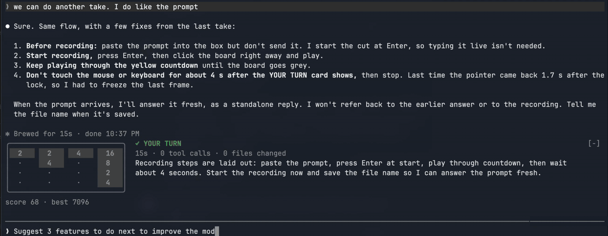

# Twenty Forty-Wait

Don't let your attention wander off while waiting for Claude Code's answer.

A small 2048 game sits right above the prompt, so you can stay in Claude Code
while it works instead of switching to another tab. Claude's output still
appears above it as usual: glance at it or follow along whenever you want, and
play a few moves when you feel like it.

2048 was chosen because the attention it gets is entirely up to you: as much
or as little as you like, whenever you like. Leave it at any moment and pick
it up where you left off. Click the board to play, press Tab to type.

The game also shows what Claude is doing. When Claude stops, the board locks
behind a **✓ YOUR TURN** card that says what happened and what to do next.

## Install

    /plugin install twenty-forty-wait --marketplace leonidb/claude-code-mods

Run `/fortywait` to show the game; run it again to hide it.

Needs Claude Code 2.1.289 or later. Tested with Claude Code 2.1.296.

## Use

- **Play:** click the board, then use the arrows.
- **Type:** press Tab or Esc, or click the prompt.
- **When Claude stops:** a long turn gets 5 seconds to finish your move, then the board locks until your next prompt.
- **One game per session.** Your best score is kept.

## What leaves your machine

Only Claude's own words, for the card's summary. After a turn of 10 seconds
or longer that ends normally with a reply of 200 characters or more, that
reply is sent to Claude Haiku, with fixed instructions, to write the summary:
the whole reply if it's 8,000 characters or less, otherwise its first 2,000
and last 6,000 characters. That text can include anything Claude wrote in the
reply, such as file paths, quoted output or code. It goes through the same
connection as the rest of your Claude Code session (Anthropic, or the
provider or gateway your session uses, such as Bedrock or Vertex), and adds a
little to your usage.

Nothing else from the session is sent: not your prompts, tool calls or files.
Nothing at all is sent before your first `/fortywait`, or after you run it
again. A reply already on its way to Haiku at that moment can't be called
back.

The mod keeps two values in Claude Code's plugin storage: whether the game is
on, and your best score.

## Known limits

- Entering the game takes a click; there's no keyboard way in yet.
- After Esc or a prompt click, the label updates once you type. Tab switches at once.
- Small windows show one line: the full game needs about 24 rows.
- While you play, Claude Code's shortcuts wait until you press Tab. Ctrl+C still interrupts.
- `--resume` starts a new game.

## Update and uninstall

Third-party marketplaces don't auto-update by default. To update:

    /plugin marketplace update leonidb
    /plugin update twenty-forty-wait@leonidb

Or turn on auto-update: `/plugin`, then **Marketplaces**, select `leonidb`,
then **Enable auto-update**.

To uninstall:

    /plugin uninstall twenty-forty-wait@leonidb

---

An independent community mod, not affiliated with or endorsed by Anthropic.
[Apache License 2.0](LICENSE). Design notes: [DESIGN.md](DESIGN.md).
